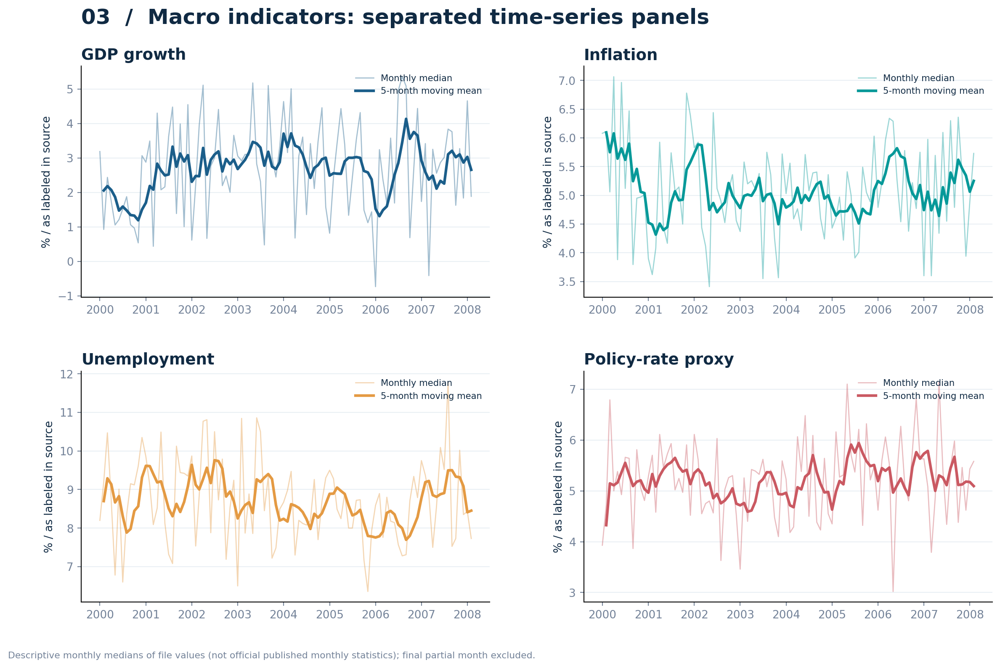
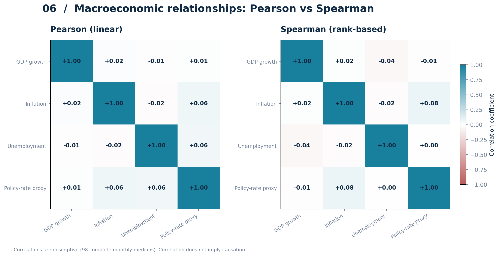
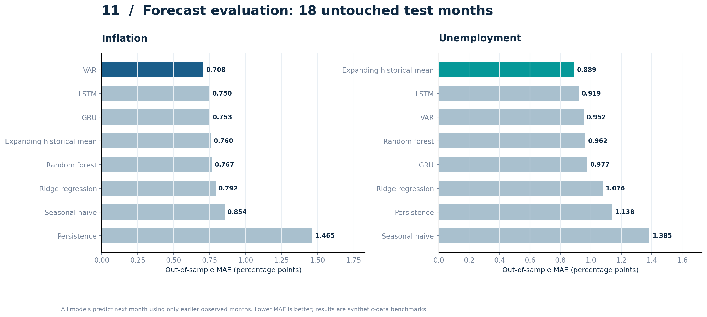
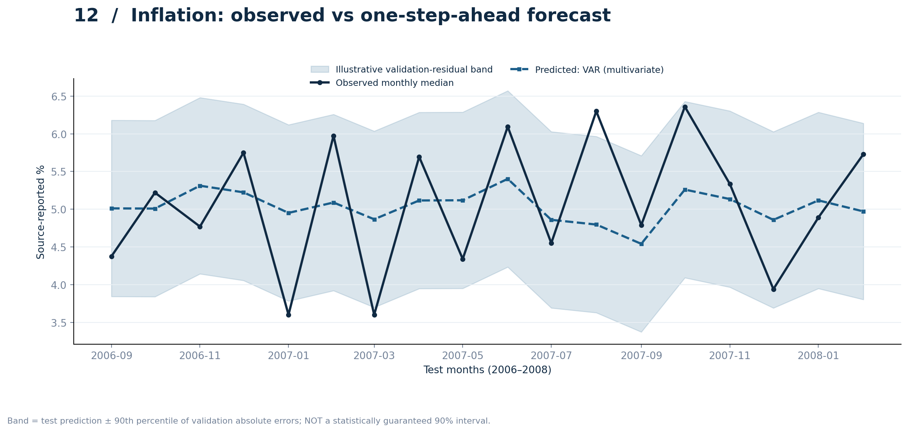
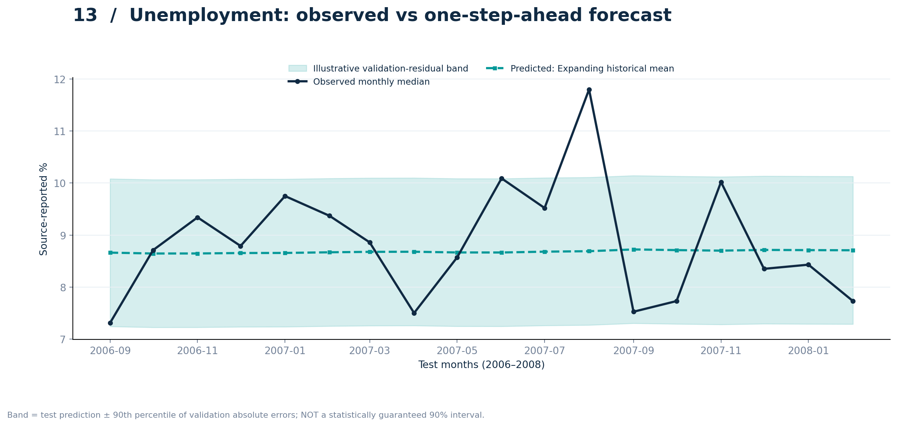

# Finance & Economics Time-Series Analysis

**NYU Data Science Bootcamp | Final Group Project | November 2026**  
**Team:** Aiden · Hanwen · Ray Duan

A reproducible, end-to-end time-series research project that explores financial and macroeconomic indicators, audits data quality, engineers temporal features, and compares classical machine learning, multivariate statistics, and deep learning forecasting methods.

> [!IMPORTANT]
> **Research validity:** The supplied dataset contains implausible U.S. stock-index observations on weekends and other unusual temporal patterns. Its original data-generating process has **not** been independently verified. All reported forecasts are **educational, file-based model evaluations**, **not validated forecasts of the U.S. economy or financial markets**.

## Project at a Glance

| Item | Details |
|---|---|
| **Research objective** | Explore economic and market relationships; evaluate one-month-ahead forecasting workflows |
| **Raw dataset** | 3,000 rows, 24 columns (22 numerical variables) |
| **Original date range** | January 1, 2000 – March 18, 2008 |
| **Selected indicators** | GDP growth, inflation, unemployment, interest rates, stock-index prices, gold, oil, and foreign exchange |
| **Modeling data** | 98 complete months of monthly medians derived from the supplied daily records |
| **Forecast targets** | File-derived monthly inflation and unemployment rates |
| **Methods compared** | 8 forecasting approaches, from persistence baselines to VAR, LSTM, and GRU |
| **Evaluation** | Chronological train / validation / test split; MAE, RMSE, MAPE, and sMAPE |

## Research Questions

1. What do the data reveal about the distribution, time dependence, and apparent relationships of economic and financial indicators?
2. What issues in the supplied data may compromise interpretation or forecasting?
3. How do simple forecasting baselines compare with traditional ML, VAR, LSTM, and GRU models on the same chronological holdout?
4. What additional steps would be needed to conduct credible real-world economic forecasting?

## Methodology

The work combines the team's initial exploratory notebooks into a consistent analytical pipeline.

| Stage | What we did | Main outputs |
|---|---|---|
| **1. Dataset exploration** | Inspected schema, date coverage, missingness, duplicates, OHLC logic, weekend records, and unusual changes | Data quality audit and diagnostic figures |
| **2. EDA** | Examined distributions, monthly trends, seasonality, Pearson/Spearman correlations, differenced relationships, and cross-correlations | Time-series plots, seasonal plots, and heatmaps |
| **3. Cleaning & alignment** | Preserved raw data, separated stock indices, excluded weekend stock observations from the observed-market subset, and removed the incomplete final month for modeling | Consistent 98-month analysis table |
| **4. Feature engineering** | Generated lagged indicators, rolling statistics, changes, and spread-related features using historical observations | Modeling features and data dictionary |
| **5. Forecast development** | Evaluated simple baselines, regularized and tree-based ML, VAR, LSTM, and GRU | Predictions and model-comparison table |
| **6. Evaluation & communication** | Compared 18 holdout months and visualized observed versus predicted values | MAE/RMSE/MAPE/sMAPE, report, slides, and optional explorer |

**Time-series precautions:** The model comparisons use observed-history, rolling **one-month-ahead** forecasts. Stock-index observations are kept separate, and the project does not backfill future prices into forecasting features. The monthly macroeconomic series are descriptive aggregations of the supplied CSV, **not official monthly government releases**.

## Data Quality: A Central Finding

The dataset appears complete but raises important questions about historical credibility.

| Check | Observed result |
|---|---:|
| Missing cells | **0** |
| Duplicate rows | **0** |
| Duplicate dates | **0** |
| Records dated on weekends | **858 / 3,000 (28.6%)** |
| Adjacent daily GDP-growth changes greater than 5 percentage points | **1,285** |
| Adjacent daily inflation changes greater than 3 percentage points | **1,490** |

The data also include index-price and trading-volume records on dates when major U.S. stock exchanges were closed. These findings suggest the input may be synthetic or otherwise unsuitable as an authenticated historical record. They **do not** establish the exact generation mechanism.



*Figure 1. Macroeconomic indicators are displayed separately to keep each variable and scale readable.*



*Figure 2. Descriptive Pearson correlations in the supplied monthly-aggregated dataset; correlation does not establish causation.*

## Forecasting Experiments

The modeling sample consists of **98 complete months** (January 2000–February 2008). Data are divided chronologically:

| Split | Period | Months |
|---|---|---:|
| Training | Jan 2000 – Dec 2004 | 60 |
| Validation | Jan 2005 – Aug 2006 | 20 |
| Test | Sep 2006 – Feb 2008 | 18 |

### Models Evaluated

- **Simple baselines:** persistence, 12-month seasonal naive, expanding historical mean
- **Machine learning:** Ridge regression, Random Forest
- **Multivariate time series:** Vector Autoregression (VAR)
- **Deep learning:** Long Short-Term Memory (LSTM), Gated Recurrent Unit (GRU)

### Selected Holdout Results

The following models achieved the lowest **test MAE** for each target among the eight compared methods:

| Target | Lowest-test-MAE model | MAE (percentage points) | RMSE (percentage points) | MAPE |
|---|---|---:|---:|---:|
| Inflation Rate | **VAR** | **0.708** | 0.809 | 14.68% |
| Unemployment Rate | **Expanding historical mean** | **0.889** | 1.135 | 9.85% |

**Interpretation:** The winners above are *post hoc rankings on one 18-month test period*, not claims of statistically proven superiority. The historical-mean baseline outperforming more complex approaches for unemployment demonstrates why baseline comparisons are essential. Results are **not** evidence of reliable real-market forecasting.



*Figure 3. Holdout MAE by model for both forecast targets (lower is better).*

| Inflation forecast | Unemployment forecast |
|---|---|
|  |  |

*Figure 4. One-month-ahead test predictions versus observed file-derived values. Shaded residual-based bands are illustrative only; they are **not calibrated statistical confidence intervals**.*

For all 16 target–model combinations and the full metrics, see [`results/model_comparison_metrics.csv`](results/model_comparison_metrics.csv). Detailed test predictions and protocol settings are also saved in [`results/`](results/).

## Repository Structure

```text
.
├── README.md
├── requirements.txt
├── dashboard.py                         # Optional Streamlit results explorer
├── data/
│   └── finance_economics_dataset.csv   # Supplied raw input
├── src/
│   └── project_pipeline.py             # Reproducible processing and model workflow
├── deliverables/
│   ├── Financial_Economics_Final_Integrated.ipynb
│   ├── Financial_Economics_Final_Report.docx
│   ├── Financial_Economics_Final_Presentation.pptx
│   └── Final_Presentation_Script_and_QA.md
├── figures/                             # 14 exported research figures
├── results/                             # Audits, features, metrics, predictions, protocol
├── sources/                             # Original project brief and team notebooks
└── TEAM_INTEGRATION_AUDIT.md
```

The paths above assume that the contents of the **`Financial_Economics_Final_Project` folder** are uploaded to the **root of your GitHub repository**. If you keep the enclosing folder as a subdirectory, adjust relative links accordingly.

## Getting Started

### 1. Clone your repository and enter the project folder

```bash
git clone <YOUR_REPOSITORY_URL>
cd <YOUR_REPOSITORY_FOLDER>
```

Replace the angle-bracket placeholders with your own repository URL and local directory name.

### 2. Set up Python

Python **3.10+** is recommended.

```bash
python -m venv .venv
```

Activate it:

```bash
# macOS / Linux
source .venv/bin/activate

# Windows PowerShell
.venv\Scripts\Activate.ps1
```

Then install dependencies:

```bash
python -m pip install -r requirements.txt
```

### 3. Reproduce the analysis and model comparison

```bash
python src/project_pipeline.py
```

This script reads the input from `data/`, performs the research pipeline, and writes figures and tabular results to `figures/` and `results/`.

To run the explanatory notebook instead:

```bash
jupyter notebook deliverables/Financial_Economics_Final_Integrated.ipynb
```

Use **Run All** after opening it. The notebook contains the executed analysis and figure outputs included with the project.

### 4. Optional: Explore saved results in Streamlit

```bash
streamlit run dashboard.py
```

The dashboard visualizes **existing evaluated results**. It is not a real-time financial-data service or a deployed forecasting product.

> **Reproducibility note:** Random seeds are set in the Python pipeline, but exact neural-network outputs can still vary slightly across package versions and compute environments.

## Deliverables

- [**Integrated Jupyter Notebook**](deliverables/Financial_Economics_Final_Integrated.ipynb) — step-by-step analysis with code, visualizations, and outputs.
- [**Final Research Report**](deliverables/Financial_Economics_Final_Report.docx) — methods, results, limitations, and conclusions.
- [**Final Presentation Slides**](deliverables/Financial_Economics_Final_Presentation.pptx) — summary for the course presentation.
- [**Presentation Script and Q&A**](deliverables/Final_Presentation_Script_and_QA.md) — speaking notes and possible reviewer questions.
- [**Team Integration Audit**](TEAM_INTEGRATION_AUDIT.md) — how the three original approaches were combined.

## Team Contributions

The project integrates analytical work submitted by three team members:

| Team member | Main source contribution |
|---|---|
| **Aiden** | Dataset exploration, structured EDA, separate indicator visualizations, and explanatory narrative |
| **Hanwen** | Detailed quality checks, time-series diagnostics, preprocessing, and feature engineering |
| **Ray Duan** | Spearman correlation, first-difference comparisons, seasonality plots, and alternative lag analysis |

The integrated final project adds the unified forecasting protocol, eight-model evaluation, reproducible results, and final presentation artifacts. See [`TEAM_INTEGRATION_AUDIT.md`](TEAM_INTEGRATION_AUDIT.md) for details.

## Limitations and Future Work

**The most important limitation is source credibility.** Despite having no missing values, the data exhibit implausible market dates and excessive day-to-day variation. The original provider and collection/generation method are not verified; the monthly variables used here should not be interpreted as official published statistics.

Further limitations include a relatively small monthly sample, an 18-month test set, and uncertainty about whether apparent relationships reflect meaningful economic behavior. The forecast bands are illustrative, not calibrated. This repository is provided for **education, methodology demonstration, and reproducible analysis**, not investment advice or policy decisions.

Recommended next steps:

1. Rebuild the data pipeline from **verifiable, timestamped sources** (for example, [FRED](https://fred.stlouisfed.org/), [BEA](https://www.bea.gov/), and [BLS](https://www.bls.gov/)).
2. Align reported frequencies and publication dates before modeling to prevent look-ahead bias.
3. Reassess seasonality, stationarity, and lead–lag relationships on authenticated data.
4. Use rolling-origin backtesting, additional holdout windows, and calibrated uncertainty estimates.
5. Re-evaluate whether VAR and deep models add value over simple baselines.

### Data provenance and redistribution

A [similarly named public Kaggle dataset](https://www.kaggle.com/datasets/khushikyad001/finance-and-economics-dataset-2000-present) was identified during source investigation, but the upstream data-generation process was not independently confirmed. **Verify the dataset's license and redistribution permissions before publishing the raw CSV in a public repository.** No license for the underlying dataset is implied by this README.

---

**Project context:** NYU Data Science Bootcamp · Finance & Economics Time-Series Analysis · November 2026
